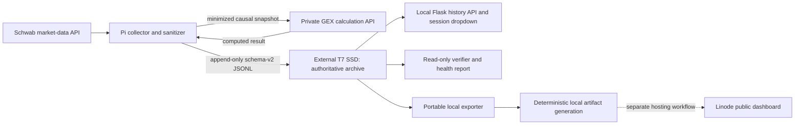

# Historical archive architecture

## Roles and data flow



The Raspberry Pi collector obtains SPX and NDX option data through the locally
configured Schwab app. It sanitizes and minimizes the input, sends that snapshot
to the private calculation API, and appends the returned computed result and
causal input to the archive. The private calculation implementation and its
request contract are outside this repository's scope.

The external T7 SSD is the primary historical record. Choose a mount point on
the local host, then set `FOXCHASE_GEX_DATA_DIR` to the archive directory beneath
it and `FOXCHASE_GEX_REQUIRED_MOUNT` to the mount root. For example, replace
this placeholder with the operator-selected mount point:

```bash
export ARCHIVE_MOUNT=/path/to/mounted-external-ssd
export FOXCHASE_GEX_DATA_DIR="$ARCHIVE_MOUNT/foxchase-gex/archive"
export FOXCHASE_GEX_REQUIRED_MOUNT="$ARCHIVE_MOUNT"
```

The required-mount check prevents collection from writing to the system disk
when the SSD is absent. Back up the T7 independently; Linode's copy or index
does not replace it.

Linode has a separate public hosting and historical publishing role. This
repository contains local archiving, UI source/deployment references, and a
Schwab refresh patch, but no Linode historical publisher implementation. The
portable exporter added here writes only to a local filesystem. It contains no
upload client, remote credentials, or deployment action.

## Local Historical Session API

The existing local dashboard discovers files beneath the configured archive
root and uses these unchanged endpoints:

- `GET /api/history/{symbol}/sessions` lists dates and line counts.
- `GET /api/history/{symbol}/{date}/timeline` supplies capture times, spot, and
  the existing display label.
- `GET /api/history/{symbol}/{date}/snapshot?index={n}` returns the stored result
  for the replay slider.

The dropdown reads the local `SPX/YYYY-MM-DD.jsonl` and
`NDX/YYYY-MM-DD.jsonl` files through `gex_client.archive`. The new verifier and
exporter are independent tools; they do not replace these routes or rewrite the
archive. The current UI reader skips malformed JSON lines for display, so use
`history_verify` to identify damaged records before publication.

## Trust boundaries

1. Schwab credentials and OAuth tokens stay in local configuration and token
   storage; they are not part of an archive frame.
2. `causal_input` is minimized, but includes sanitized option-chain values and
   must still be treated as restricted market data.
3. `result` is returned by a private calculation service. It can contain
   computed values or classifier labels whose publication rights differ.
4. Archive hashes detect accidental changes when the stored hash is retained;
   they are not signatures and do not establish who created a frame.
5. The exporter copies only its explicit computed-field allowlist. It never
   copies `causal_input`, provenance, authentication data, account data, or
   `patterns` labels. Non-synthetic data requires a separate local policy that
   records an affirmative redistribution review.

Synthetic examples under `examples/synthetic_archive/` are generated locally,
contain no Schwab observations, and need no API credentials or network access.
